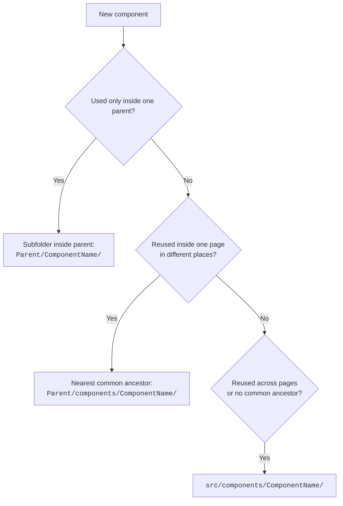
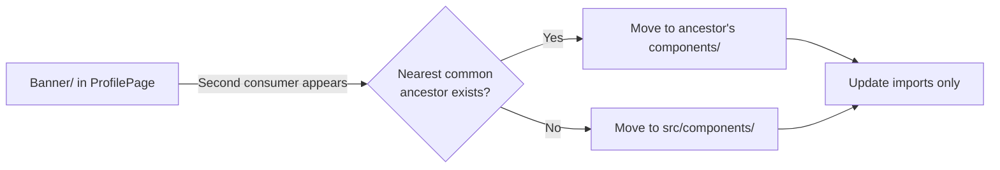

# Simple Architecture

**Simple Architecture = Clean Architecture + VIPER**, applied to a tree of React
components. Views are JSX + `usePresenter()`. Components mirror the visual tree:
every visual block is a component folder.

## 1. Repository layout

```
src/
├── App.tsx                 # root component
├── main.tsx                # entry point
├── router.tsx              # single routing file (React Router or TanStack Router)
├── providers/              # cross-cutting providers (theme, auth, i18n)
├── pages/                  # route-level components (same anatomy as components)
├── components/             # GLOBAL reusable UI (kit); used across pages
├── services/               # business logic and request functions
├── api/                    # ky client (client.ts) and low-level API glue
├── hooks/                  # reusable non-presenter hooks (useDebounce, …)
├── utils/                  # global pure utilities
└── types/                  # shared types
```

`src/components/` is the global UI kit. Do not place non-reusable blocks there.

## 2. Component anatomy

Every component is a folder named after the component (`PascalCase`):

```
ComponentName/
├── index.ts                # public API: export { default } from './ComponentName'
├── ComponentName.tsx       # view: JSX + JSX-only logic (conditional rendering, mapping)
├── types.ts                # all types for this component (props, view-model)
├── usePresenter.ts         # component logic
├── stylex.ts               # styles (stylex.create); all styles for this component
├── utils.ts                # optional pure helpers for this component
└── hooks/                  # optional sub-hooks, see §5
```

- Views use **default export**. `index.ts` is a single-line re-export.
- Do not prefix technical files with the component name (`types.ts`, not
  `Content.types.ts`). The folder already scopes them.
- Technical folders are `lowercase` (`components/`, `hooks/`, `utils/`).
- Component folders are `PascalCase`.

## 3. Where does a component live?

Decide by **reuse scope**, not by size.



Examples:

- `ProfilePage/Banner/` — `Banner` is only used by `ProfilePage`.
- `ProfilePage/components/Stats/` — `Stats` is reused in several places within
  `ProfilePage`.
- `src/components/Button/` — `Button` is used across pages.

Never pre-emptively move a component up. Promote it only when a second consumer
appears.

## 4. Import rule (strict)

- Import **only** from a component's `index.ts`.
- Never import a component's internals from outside that component folder
  (`./Content/Content.tsx`, `./Content/usePresenter.ts` are forbidden from
  outside).
- Inside a component folder, direct relative imports are allowed.

## 5. View and presenter

- **`ComponentName.tsx`** — JSX only. Allowed logic: conditional rendering, list
  mapping, trivial JSX-local expressions. No business logic, no effects, no data
  fetching.
- **`usePresenter.ts`** — the component's logic. Returns the view-model consumed
  by the view. Prop types live in `types.ts`; export the return type of the
  presenter from `types.ts` as well.
- **Sub-hooks** — when presenter logic grows, split it into sub-hooks:
  - 1–2 sub-hooks: files in the same folder (`useBannerData.ts`,
    `useBannerActions.ts`).
  - 3+ sub-hooks: group them into `hooks/` (`hooks/useBannerData.ts`).
- **Sub-hooks return plain data/handlers; they do not render.**
- **HTTP / business logic** does not live in the presenter. Presenter calls
  `src/services/` (or `src/api/`); services own request functions.
- JSX decomposition limits are not enforced for now; logic limits are (§7).

## 6. Routing and HTTP

- **Routing**: one central file `src/router.tsx`. Pages are folders in
  `src/pages/PageName/` with the same anatomy as components. Router library is
  React Router or TanStack Router (final choice is a project decision, not an
  architecture concern).
- **HTTP**: a single configured ky client lives in `src/api/client.ts`. Request
  functions live in `src/services/` (feature-level) or `src/api/` (generic
  wrappers). Presenters never call `ky` or `fetch` directly.

## 7. Size limits

- **Logic files** (`usePresenter.ts`, sub-hooks, `utils.ts`): **≤ 120 lines
  each.** When a logic file approaches the limit, extract pure helpers into
  `utils.ts` or split into sub-hooks.
- **Views (`.tsx`) and styles (`stylex.ts`)**: no hard limit for now. Keep them
  readable; split the visual tree when it improves comprehension.

## 8. Examples

Profile page with one non-reusable block and one page-local reusable block:

```
pages/ProfilePage/
├── index.ts
├── ProfilePage.tsx
├── types.ts
├── usePresenter.ts
├── stylex.ts
├── Banner/                       # used only by ProfilePage
│   ├── index.ts
│   ├── Banner.tsx
│   ├── types.ts
│   ├── usePresenter.ts
│   └── stylex.ts
└── components/
    └── Stats/                    # reused in several places within ProfilePage
        ├── index.ts
        ├── Stats.tsx
        ├── types.ts
        ├── usePresenter.ts
        └── stylex.ts
```

Promotion path when `Banner` becomes needed by `Sidebar` too:



Nothing inside `Banner/` changes; only the folder location and the import paths
in its consumers.

## 9. Non-goals

- No Feature-Sliced Design, Atomic Design, or other named architectures.
- No barrel files beyond each component's `index.ts`.
- No premature abstraction: do not create `services/`, `hooks/`, or
  `components/` files/folders until a real consumer exists.
