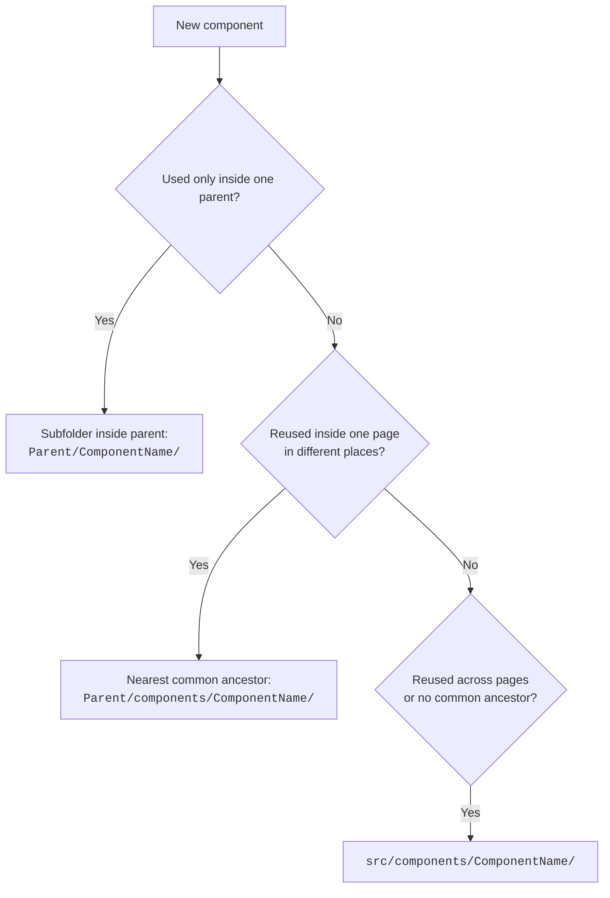
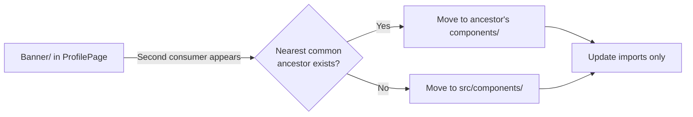

# Simple Architecture

**Simple Architecture = Clean Architecture + VIPER**, applied to a tree of React
components. Views are JSX + `usePresenter()`. Components mirror the visual tree:
every visual block is a component folder.

## 1. Repository layout

```text
src/
├── App.tsx                 # root component
├── main.tsx                # entry point
├── router.tsx              # single routing file (React Router or TanStack Router)
├── providers/              # cross-cutting providers (theme, auth, i18n)
├── pages/                  # route-level components (same anatomy as components)
├── components/             # GLOBAL reusable UI (kit); used across pages
├── services/               # business logic and request functions
├── api/                    # ky client (client.ts) and low-level API glue
├── hooks/                  # reusable non-presenter hooks (useDebounce, …)
├── utils/                  # global pure utilities
└── types/                  # shared types
```

`src/components/` is the global UI kit. Do not place non-reusable blocks there.

## 2. Component anatomy

Every component is a folder named after the component (`PascalCase`):

```text
ComponentName/
├── index.ts                # public API: export { default } from './ComponentName'
├── ComponentName.tsx       # view: JSX + JSX-only logic (conditional rendering, mapping)
├── types.ts                # all types for this component (props, view-model)
├── usePresenter.ts         # component logic
├── stylex.ts               # styles (stylex.create); all styles for this component
├── utils.ts                # optional pure helpers for this component
└── hooks/                  # optional sub-hooks, see §4
```

- Views use **default export**. `index.ts` is a single-line re-export.
- Do not prefix technical files with the component name (`types.ts`, not
  `Content.types.ts`). The folder already scopes them.
- Technical folders are `lowercase` (`components/`, `hooks/`, `utils/`).
- Component folders are `PascalCase`.

## 3. Where does a component live?

Decide by **reuse scope**, not by size.



Examples:

- `ProfilePage/Banner/` — `Banner` is only used by `ProfilePage`.
- `ProfilePage/components/Stats/` — `Stats` is reused in several places within
  `ProfilePage`.
- `src/components/Button/` — `Button` is used across pages.

Never pre-emptively move a component up. Promote it only when a second consumer
appears.

## 4. View, presenter, and sub-hooks

- **`ComponentName.tsx`** — JSX only. Allowed logic: conditional rendering, list
  mapping, trivial JSX-local expressions. No business logic, no effects, no
  direct HTTP calls.
- **`usePresenter.ts`** — accepts component `props` (when needed) and returns
  the view-model consumed by the view. Effects, subscriptions, state
  transitions, and calls to `services/` / `api/` live here or in sub-hooks — not
  in the view.
- **Types (`types.ts`)** — define component `Props` and export the presenter
  return type (`ViewModel`) from `types.ts`.
- **Sub-hooks** — when presenter logic grows, split it into sub-hooks:
  - 1–2 sub-hooks: files in the same component folder (e.g. `useBannerData.ts`,
    `useBannerActions.ts`).
  - 3+ sub-hooks: move/group them into `hooks/` (`hooks/useBannerData.ts`).
  - Sub-hooks return plain data/handlers; they do not return JSX.
- **Pages (`src/pages/PageName/`)** — follow the same anatomy as components;
  page data loading, route params handling, and coordination live in the page's
  `usePresenter.ts` and `services/`.

## 5. Import rule (strict)

- Import **only** from a component's `index.ts`.
- Never import a component's internals from outside that component folder
  (`./Content/Content.tsx`, `./Content/usePresenter.ts` are forbidden from
  outside).
- Inside a component folder, direct relative imports are allowed.

## 6. Routing and HTTP

- **Routing**: one central file `src/router.tsx`. Pages are folders in
  `src/pages/PageName/` with the same anatomy as components. Router library is
  React Router or TanStack Router (project-level choice).
- **HTTP**: a single configured `ky` client lives in `src/api/client.ts`.
  Low-level request/API functions live in `src/api/`; domain/business logic and
  data orchestration live in `src/services/`. Presenters never call `ky` or
  `fetch` directly.

## 7. Size limits

- **`usePresenter.ts` (and sub-hooks)**: **≤ 120 lines each**. When a presenter
  approaches the limit, extract sub-hooks or pure helpers into `utils.ts`.
- **Views (`ComponentName.tsx`), styles (`stylex.ts`), types (`types.ts`), and
  `utils.ts`**: no hard 120-line limit for now. Keep them readable and split
  when it genuinely improves clarity.

## 8. Reference component example

```ts
// ComponentName/types.ts
export type ComponentNameProps = {
  initialQuery?: string;
};

export type ComponentNameViewModel = {
  query: string;
  onQueryChange: (value: string) => void;
};
```

```ts
// ComponentName/usePresenter.ts
import { useState } from 'react';
import type { ComponentNameProps, ComponentNameViewModel } from './types';

export function usePresenter({
  initialQuery = ''
}: ComponentNameProps): ComponentNameViewModel {
  const [query, setQuery] = useState(initialQuery);

  return {
    query,
    onQueryChange: setQuery
  };
}
```

```tsx
// ComponentName/ComponentName.tsx
import * as stylex from '@stylexjs/stylex';
import { styles } from './stylex';
import type { ComponentNameProps } from './types';
import { usePresenter } from './usePresenter';

export default function ComponentName(props: ComponentNameProps) {
  const { query, onQueryChange } = usePresenter(props);

  return (
    <div {...stylex.props(styles.root)}>
      <input
        value={query}
        onChange={e => onQueryChange(e.target.value)}
      />
    </div>
  );
}
```

```ts
// ComponentName/index.ts
export { default } from './ComponentName';
export type { ComponentNameProps, ComponentNameViewModel } from './types';
```

## 9. Examples & promotion path

Profile page with one non-reusable block and one page-local reusable block:

```text
pages/ProfilePage/
├── index.ts
├── ProfilePage.tsx
├── types.ts
├── usePresenter.ts
├── stylex.ts
├── Banner/                       # used only by ProfilePage
│   ├── index.ts
│   ├── Banner.tsx
│   ├── types.ts
│   ├── usePresenter.ts
│   └── stylex.ts
└── components/
    └── Stats/                    # reused in several places within ProfilePage
        ├── index.ts
        ├── Stats.tsx
        ├── types.ts
        ├── usePresenter.ts
        └── stylex.ts
```

Promotion path when `Banner` becomes needed by another consumer:



Nothing inside `Banner/` changes; only the folder location and the import paths
in its consumers.

## 10. Non-goals

- No Feature-Sliced Design, Atomic Design, or other named architectures.
- No barrel files beyond each component's `index.ts`.
- No speculative abstractions: do not create new feature/helper files or folders
  before a real need appears.
