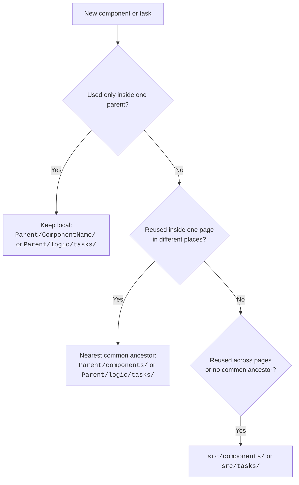
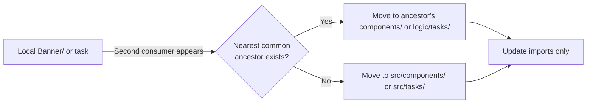

# Simple Architecture

**Simple Architecture = Clean Architecture + VIPER**, applied to a tree of React
components. Views are JSX + `usePresenter()`. Components mirror the visual tree:
every visual block is a component folder.

## 1. Repository layout

```text
src/
├── App.tsx                 # root component
├── main.tsx                # entry point
├── router.tsx              # single routing file (React Router or TanStack Router)
├── providers/              # cross-cutting providers (theme, auth, i18n)
├── pages/                  # route-level components (same anatomy as components)
├── components/             # GLOBAL reusable UI (kit); used across pages
├── tasks/                  # GLOBAL reusable use cases (business logic), verb-named
├── store/                  # state management (Redux / MobX / Zustand), direct store access
├── api/                    # ky client (client.ts) and low-level API glue
├── hooks/                  # reusable non-presenter hooks (useDebounce, …)
├── utils/                  # global pure utilities
└── types/                  # shared types
```

- `src/components/` is the global UI kit. Do not place non-reusable blocks
  there.
- `src/tasks/` holds reusable business use cases shared across different
  components/pages. Single-use tasks live inside their component's
  `logic/tasks/`.

## 2. Component anatomy

Every component is a folder named after the component (`PascalCase`):

```text
ComponentName/
├── index.ts                # public API: export { default } from './ComponentName'
├── ComponentName.tsx       # view: JSX + JSX-only logic (conditional rendering, mapping)
├── types.ts                # all types for this component (props, view-model)
├── stylex.ts               # styles (stylex.create); all styles for this component
├── utils.ts                # optional pure helpers for this component
└── logic/                  # component logic layer (presenter, sub-hooks, local tasks)
    ├── usePresenter.ts     # component presenter (bridge between View and Tasks)
    ├── useSubHook.ts       # optional sub-hooks (or logic/hooks/ if 3+)
    └── tasks/              # optional single-use business tasks for this component
        └── doSomething.ts  # or doSomething/ folder if split into multiple files
```

- For simple components without local tasks or sub-hooks, `usePresenter.ts` may
  live either at the component root or inside `logic/usePresenter.ts` — keep it
  consistent within a feature; once sub-hooks or local `tasks/` appear, group
  them under `logic/`.
- Views use **default export**. `index.ts` is a single-line re-export.
- Do not prefix technical files with the component name (`types.ts`, not
  `Content.types.ts`). The folder already scopes them.
- Technical folders are `lowercase` (`components/`, `logic/`, `tasks/`,
  `hooks/`, `utils/`).
- Component folders are `PascalCase`.

## 3. Where do components and tasks live?

Decide by **reuse scope**, not by size.



Examples:

- `ProfilePage/Banner/` — `Banner` is only used by `ProfilePage`.
- `ProfilePage/components/Stats/` — `Stats` is reused in several places within
  `ProfilePage`.
- `LogoutButton/logic/tasks/logout.ts` — `logout` is only triggered from
  `LogoutButton`.
- `src/tasks/unsubscribePush.ts` — `unsubscribePush` is reused by multiple
  tasks/flows.
- `src/components/Button/` — `Button` is used across pages.

Never pre-emptively move a component or task up. Promote it only when a second
consumer appears.

## 4. VIPER layers in Simple Architecture

- **View (`ComponentName.tsx`)** — JSX only. Allowed logic: conditional
  rendering, list mapping, trivial JSX-local expressions. No business logic, no
  effects, no direct HTTP or store calls.
- **Presenter (`usePresenter.ts`)** — bridge between View and Tasks. Accepts
  component `props` (when needed), manages UI state (`loading`, `error`), calls
  tasks on user events, handles environment-specific navigation (**Router**),
  and returns the view-model consumed by the view.
  - **Sub-hooks**: when presenter logic grows, split into sub-hooks (`1–2` in
    `logic/`, `3+` in `logic/hooks/`). Sub-hooks return plain data/handlers, not
    JSX.
- **Interactor / Use Cases (`tasks/`)** — application business logic (user
  scenarios).
  - Each task is a **plain JS/TS function** (sync or `async`), named with a
    **verb** (`login`, `logout`, `buyItem`, `publishPost`).
  - **Zero React dependency**: never import React, hooks, or router utilities
    inside `tasks/`. Tasks must remain framework-agnostic.
  - **Direct store access**: tasks read/update state directly via the store
    instance (`store.dispatch` / `store.getState` in Redux, store methods in
    MobX, `useStore.getState()` / `setState()` in Zustand) without middleware
    wrappers like `redux-thunk` or `redux-saga`.
  - **Composition**: a task can call other tasks (e.g. `logout` calls
    `unsubscribePush`) and API abstractions (`src/api/`).
  - If a task grows large, turn `taskName.ts` into a folder `taskName/` with an
    entry `taskName.ts` (or `index.ts`) and helper files.
- **Entity (`src/store/`)** — domain state and state-updating
  reducers/actions/methods.
- **Router (`src/router.tsx` + navigation in Presenter)** — central route table
  in `src/router.tsx`; imperative redirects happen in `usePresenter.ts` after a
  task resolves (because navigation is environment/UI-specific, not business
  logic).
- **Types (`types.ts`)** — define component `Props` and export the presenter
  return type (`ViewModel`) from `types.ts`.

## 5. Import rule (strict)

- Import **only** from a component's `index.ts`.
- Never import a component's internals from outside that component folder
  (`./Content/Content.tsx`, `./Content/logic/usePresenter.ts` are forbidden from
  outside).
- Inside a component folder, direct relative imports are allowed.
- Tasks may import from `src/store/`, `src/api/`, `src/utils/`, `src/types/`,
  and other tasks in `src/tasks/`, never from React or View/Presenter layers.

## 6. Routing and HTTP

- **Routing**: one central file `src/router.tsx`. Pages are folders in
  `src/pages/PageName/` with the same anatomy as components. Imperative
  navigation (e.g. redirect after `await logout()`) is triggered inside
  `usePresenter.ts`, never inside a task.
- **HTTP**: a single configured `ky` client lives in `src/api/client.ts`.
  Low-level request/API abstractions live in `src/api/`. Tasks call `src/api/`
  functions rather than coupling directly to `ky`, transport details, or
  headers.

## 7. Size limits

- **`usePresenter.ts` (and sub-hooks) and `tasks/` files**: **≤ 120 lines
  each**. When a presenter approaches the limit, extract sub-hooks or pure
  helpers into `utils.ts`. When a task approaches the limit, split it into
  sub-tasks or convert the task file into a folder of focused files (`≤ 120`
  lines each).
- **Views (`ComponentName.tsx`), styles (`stylex.ts`), types (`types.ts`), and
  `utils.ts`**: no hard 120-line limit for now. Keep them readable and split
  when it genuinely improves clarity.

## 8. Reference component & task example

```ts
// LogoutButton/logic/tasks/logout.ts
import { api } from '@/api/auth';
import { store } from '@/store';
import { unsubscribePush } from '@/tasks/unsubscribePush';

export async function logout(): Promise<void> {
  await unsubscribePush();
  await api.logout();
  store.dispatch({ type: 'session/cleared' });
}
```

```ts
// LogoutButton/types.ts
export type LogoutButtonProps = {
  redirectTo?: string;
};

export type LogoutButtonViewModel = {
  isLoading: boolean;
  error: string | null;
  onLogout: () => void;
};
```

```ts
// LogoutButton/logic/usePresenter.ts
import { useState } from 'react';
import { useNavigate } from 'react-router-dom';
import type { LogoutButtonProps, LogoutButtonViewModel } from '../types';
import { logout } from './tasks/logout';

export function usePresenter({
  redirectTo = '/login'
}: LogoutButtonProps): LogoutButtonViewModel {
  const navigate = useNavigate();
  const [isLoading, setIsLoading] = useState(false);
  const [error, setError] = useState<string | null>(null);

  const onLogout = async () => {
    setIsLoading(true);
    setError(null);
    try {
      await logout();
      navigate(redirectTo);
    } catch (e) {
      setError(e instanceof Error ? e.message : 'Logout failed');
    } finally {
      setIsLoading(false);
    }
  };

  return { isLoading, error, onLogout };
}
```

```tsx
// LogoutButton/LogoutButton.tsx
import * as stylex from '@stylexjs/stylex';
import { styles } from './stylex';
import type { LogoutButtonProps } from './types';
import { usePresenter } from './logic/usePresenter';

export default function LogoutButton(props: LogoutButtonProps) {
  const { isLoading, error, onLogout } = usePresenter(props);

  return (
    <div {...stylex.props(styles.root)}>
      <button
        disabled={isLoading}
        onClick={onLogout}
      >
        Log out
      </button>
      {error && <span {...stylex.props(styles.error)}>{error}</span>}
    </div>
  );
}
```

```ts
// LogoutButton/index.ts
export { default } from './LogoutButton';
export type { LogoutButtonProps, LogoutButtonViewModel } from './types';
```

## 9. Examples & promotion path

Profile page with one non-reusable block, local tasks, and one page-local
reusable block:

```text
pages/ProfilePage/
├── index.ts
├── ProfilePage.tsx
├── types.ts
├── stylex.ts
├── logic/
│   ├── usePresenter.ts
│   └── tasks/
│       └── updateAvatar.ts       # used only by ProfilePage
├── Banner/                       # used only by ProfilePage
│   ├── index.ts
│   ├── Banner.tsx
│   ├── types.ts
│   ├── stylex.ts
│   └── logic/
│       └── usePresenter.ts
└── components/
    └── Stats/                    # reused in several places within ProfilePage
        ├── index.ts
        ├── Stats.tsx
        ├── types.ts
        ├── stylex.ts
        └── logic/
            └── usePresenter.ts
```

Promotion path when `Banner` or a task becomes needed by another consumer:



## 10. Non-goals

- No Feature-Sliced Design, Atomic Design, or other named architectures.
- No barrel files beyond each component's `index.ts`.
- No store middleware wrappers (`redux-thunk`, `redux-saga`) for business flows;
  tasks are plain functions accessing the store directly.
- No speculative abstractions: do not create new feature/task/helper files or
  folders before a real need appears.
